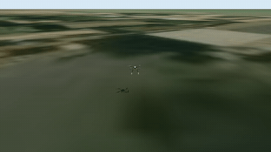
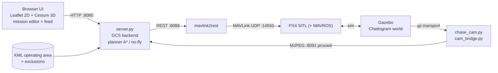

# Maritime Autonomy — Chattogram Port UAV

<div align="justify">

A full **software-in-the-loop autonomous maritime-patrol simulator**: PX4 SITL +
Gazebo (real Chattogram satellite/terrain world) + ROS 2 autonomy + a browser
Ground Control Station with live map, 3D view, a **no-fly-aware multi-waypoint
mission planner**, and a real-time **chase-camera feed** rendered from the sim.

</div>

<div align="center">



*Autonomous mission flown in PX4 SITL, rendered in Gazebo over the real Chattogram port terrain, captured from the in-sim chase camera. ([full video](media/demo.mp4))*

</div>

---

## Architecture



Full write-up: [`docs/SYSTEM_OVERVIEW.pdf`](docs/SYSTEM_OVERVIEW.pdf) ·
launch guide: [`docs/LAUNCH_GUIDE.pdf`](docs/LAUNCH_GUIDE.pdf).

## Features

- **Exclusion-aware path planning** — A* over the KML operating area; the drone
  **never enters a no-fly zone**, even if a waypoint is dropped inside one (it is
  clamped to the nearest safe point and the leg is routed around the zone).
- **Multi-waypoint mission editor** — drop an ordered chain of waypoints, each with
  its **own altitude**; adjustable auto-RTL return altitude.
- **Live web GCS** — 2D map (Leaflet) + 3D view (Cesium), telemetry HUD, arm /
  start / RTL / reposition / cargo-drop, all over MAVLink.
- **Manual ⇄ Auto toggle** — one button hands control to the RC pilot (POSCTL) or
  resumes the uploaded mission (AUTO.MISSION). On a real Pixhawk the RC always
  keeps override priority; the toggle just commands the PX4 flight mode.
- **Chase-camera feed** — a real Gazebo camera that follows the drone (look-at,
  travel-facing), streamed as MJPEG. Works headless / under Wayland (no screen
  scraping).
- **Draggable, resizable** feed and 3D windows.
- **Smooth takeoff & landing** — jerk/accel-limited PX4 tuning applied on launch.

## Repository layout

```
maritime_project/
├── gcs/         web GCS: server.py, fc_iface.py, rc_to_sitl.py, chase_cam.py, cam_bridge.py, web/
├── ros2_ws/     ROS 2 workspace — pkg maritime_autonomy (planner, geo, mission nodes, world)
├── launch/      start.sh (3-stage selector), start_all.sh, start_sitl_manual.sh, start_real.sh
├── assets/      chattogram_zones.kml (operating area + exclusion zones)
├── docs/        SYSTEM_OVERVIEW + LAUNCH_GUIDE (.tex/.pdf)
├── media/       demo.mp4 / demo.gif
└── external/    symlinks to PX4-Autopilot and mavlink2rest (not committed)
```

Paths are self-locating: `server.py` derives the project root from its own location
(override with `MARITIME_ROOT`), and the shell scripts derive it from their path.

## Prerequisites

- **ROS 2 Humble**, **Gazebo Harmonic** (`gz sim`)
- **[PX4-Autopilot](https://github.com/PX4/PX4-Autopilot)** built for SITL, with the
  `chattogram` gz world installed
- **[mavlink2rest](https://github.com/mavlink/mavlink2rest)** binary
- Python: `numpy`, `opencv-python`, and the Gazebo Python bindings
  (`gz.transport13`, `gz.msgs10`)

Link the two external dependencies into the project:

```bash
mkdir -p external
ln -s /path/to/PX4-Autopilot external/PX4-Autopilot
ln -s /path/to/mavlink2rest  external/mavlink2rest
```

## Three stages

The system runs in three stages, all launched through one selector:

```bash
bash launch/start.sh 1     # Stage 1: planning sim (autonomous, no RC)
bash launch/start.sh 2     # Stage 2: sim + manual RC control (fly the sim)
bash launch/start.sh 3     # Stage 3: real Pixhawk (no sim)
# also: planning | manual | real
```

### Stage 1 — Planning simulation (no Pixhawk, no RC)

The "earlier version": PX4 SITL + Gazebo + web GCS. `COM_RC_IN_MODE=4` (manual
control disabled). Pure autonomous mission planning.

```bash
bash launch/start.sh 1      # = launch/start_all.sh
```

Open **http://localhost:8080**, give the sim ~15 s, click **Gazebo feed**.

> **➕ Add waypoints** → **Plan route** (routes around no-fly zones) →
> **Upload mission** → **Arm** → **Start**.

### Stage 2 — Manual control in the sim (RC receiver wireless)

Same Gazebo sim, but the pilot flies the *simulated* drone with the real RC
transmitter. `COM_RC_IN_MODE=1` (MAVLink manual control enabled) +
`rc_to_sitl.py` bridges RC from the real Pixhawk to SITL:

```
RC transmitter --wireless--> receiver (on Pixhawk) --USB/MAVLink--> rc_to_sitl.py
      --HTTP/MANUAL_CONTROL--> mavlink2rest --MAVLink--> PX4 SITL (Gazebo)
```

```bash
bash launch/start.sh 2      # = launch/start_sitl_manual.sh
```

The receiver stays wired to the Pixhawk (CRSF on its RC port); the Pixhawk is
connected to the laptop over USB (`/dev/ttyACM0`, USB power only — it need not
be armed). The bridge reads `RC_CHANNELS` and forwards `MANUAL_CONTROL` to
SITL via mavlink2rest. QGC connects to the *SITL* on :14550, not the Pixhawk.

In the web UI: toggle to **Manual** (POSCTL) to fly with sticks, or **Auto**
to resume an uploaded mission. Arm via the web GCS **Arm** button, then fly.
Watch `~/rc_bridge.log` for `RC link LIVE` (or the all-zeros warning if the
receiver is unbound/unpowered).

### Stage 3 — Real Pixhawk (no sim)

The drone is the real Pixhawk 6C in the sky. RC → receiver → Pixhawk is
handled natively by PX4 firmware (do **not** use `rc_to_sitl.py` here). The
web GCS talks MAVLink over the SIYI HM30 radio (UDP `192.168.144.12:19856`)
or a USB cable if the Pixhawk is plugged in, and offers the Manual ⇄ Auto
toggle. QGC pops up on `:14550`. FPV from the HM30 camera is proxied into
the web UI (`rtsp://192.168.144.25:8554/main.264`).

```bash
bash launch/start.sh 3      # = launch/start_real.sh
# laptop Ethernet on the SIYI LAN (192.168.144.30); QGC + FPV + web GCS
```

Starts the web GCS (:8080) + `mavlink2rest` + `mav_hub.py` (SIYI UDP or
Pixhawk USB → `:14550` / `:14555`) + `rtsp_bridge.py` (FPV MJPEG on `:8091`)
+ QGroundControl. No Gazebo, no SITL-only bypass params — set RC/datalink
failsafe (`NAV_RCL_ACT`, `NAV_DLL_ACT`, `COM_RCL_EXCEPT`) in QGC.

Restart just the web layer after code changes (leaves the sim/Pixhawk running):

```bash
bash launch/restart_gcs.sh
```

## Ports

| Port  | Service |
|-------|---------|
| 8080  | GCS web UI + API + `/video.mjpeg` proxy |
| 8091  | chase-cam / FPV MJPEG bridge |
| 8088  | mavlink2rest REST API |
| 14550 | PX4 → QGroundControl (MAVLink UDP) |
| 14555 | PX4 → mavlink2rest (web GCS MAVLink UDP) |

## Notes

- The session here is **Wayland**, so the feed is a rendered Gazebo camera, not a
  desktop screen grab (which returns black under XWayland).
- `launch_chattogram_clean.sh` auto-applies **SITL-only** arming bypass params
  (`CBRK_SUPPLY_CHK`, `NAV_RCL_ACT`, …) — do **not** use these on real hardware.
  `COM_RC_IN_MODE` is set by `SITL_RC_IN_MODE` env (4 = planning, 1 = manual);
  Stage 3 (`start_real.sh`) applies none of these.
- The ROS 2 `build/`/`install/` dirs are not committed; run `colcon build` in
  `ros2_ws/` before using the MAVROS mission nodes.

## Roadmap

- Migrate onboard control from MAVROS to **uXRCE-DDS** (offboard) for the Jetson
- Downward-facing (nadir) camera feed on the real-hardware path (FPV RTSP is live)
- Rangefinder-based AGL fusion for over-water flight
